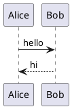

# PlantUML Lens

A Chrome extension that renders `plantuml` code blocks and standalone `.puml` files on GitHub, on local files and on the sites you add, using a TeaVM-compiled PlantUML engine that runs entirely in your browser.

**No server. No tokens. No tracking. Minimal permissions.**

It works next to [Markdown Lens](https://github.com/cjw129/markdown-lens): on a `file://` Markdown page the diagrams are rendered once Markdown Lens has finished.

> Not affiliated with the PlantUML project. See [THIRD_PARTY_NOTICES.md](THIRD_PARTY_NOTICES.md) for the components that are bundled.

## Install

1. Download `plantuml-lens.zip` from the [releases](https://github.com/cjw129/plantuml-lens/releases) page and extract it, or build it yourself (see [Build](#build)), or use the `extension/` folder of this repository as is
2. Open `chrome://extensions` and turn on **Developer mode**
3. Click **Load unpacked** and select the extracted folder (the one that contains `manifest.json`)
4. For local files turn on **Allow access to file URLs** on the extension's page in `chrome://extensions`

Reload the extension after you update the folder.

## Live demo

With the extension active, the block below renders as a sequence diagram:



## How it works

1. The content script scans the page for `plantuml` code blocks. Blocks with no language marker (a languageless fence, or an AsciiDoc `[plantuml]` listing block) are recognized too, by their `@startuml` / `@enduml` delimiters. The `puml` and `wsd` languages are accepted as aliases.
2. Each block is replaced with a sandboxed `<iframe>` packaged inside the extension.
3. The iframe loads the engine (`extension/vendor/plantuml.js`) and renders the diagram to SVG. The diagram follows the light or dark mode of the page.
4. The result is shown inline in a wrapper with a header bar: a toggle between the diagram and the original source (rendered with the site's own highlighting), copy as SVG, source or bitmap, and an editor.
5. Standalone `.puml`, `.plantuml`, `.pu` and `.wsd` files on GitHub's file view are rendered in place of the code, with a toggle back to GitHub's own code view. The source is read from the page itself, so private repositories work too.

Comments or a license header before `@startuml` (or after `@enduml`) are allowed, only the `@startXXX ... @endXXX` part is sent to the engine.

The standard library is bundled, so `!include <lib/...>` works for every library the project site publishes (C4, AWS, Azure, GCP, Kubernetes, Material, ...), as do emoji (`<:1f600:>`), `!theme` and OpenIconic (`<&icon>`).

## Sites

Open the options page (`chrome://extensions` -> PlantUML Lens -> Details -> Extension options) to choose where diagrams are rendered:

- **Built-in sites** (GitHub, GitHub Enterprise Cloud, local files) can be turned off.
- **Your sites** adds any other site that shows `plantuml` code blocks, for example a self-hosted GitLab or Gitea, or a documentation site. Type an address (`gitlab.example.com`, `https://gitlab.example.com`, `*.example.com`, `http://localhost:3000`), accept the browser's permission prompt and reload the site. A site that has a port needs `http://` or `https://` in front of it. Removing the site removes the permission.

On the sites you add the extension looks for the same code blocks it uses on GitHub. The standalone `.puml` file view is GitHub only.

## Permissions

No host permissions are requested at install time and there is no `tabs` permission. The extension declares:

- `clipboardWrite` - only for the "Copy as bitmap" button
- `storage` - only to remember which sites are turned on or off
- `scripting` - only to register the content script on the sites you add

The content script is scoped to `github.com`, `*.ghe.com` and `file://` pages. Any other site is an optional host permission that the browser asks for when you add the site, and that is given back when you remove it. The renderer page is web accessible to every site so that it can be embedded on the sites you add.

The extension runs under the stock Manifest V3 Content Security Policy (essentially `script-src 'self'`), with no relaxation. Graph layout (class, component, deployment, state and use-case diagrams) is done by Smetana, PlantUML's built-in port of the Graphviz layout algorithms, compiled into the engine, so there is no WebAssembly module and no `'wasm-unsafe-eval'`.

The engine runs inside a sandboxed iframe with an opaque origin: no network access and no shared state with the host page.

## Build

Requires Python 3.8+ (standard library only).

```bash
python build_zip.py      # -> plantuml-lens.zip, manifest.json at the root of the archive
python fetch_stdlib.py   # refresh the bundled stdlib from https://plantuml.github.io/plantuml/js-plantuml/
```

A release is created by pushing a tag that matches the version in `extension/manifest.json` (`git tag v0.4.0 && git push --tags`), the workflow in `.github/workflows/release.yml` builds the archive and publishes it.

`extension/vendor/plantuml.js` is the vendored TeaVM-compiled engine, the top-level `extension/*.min.js` files are the stdlib bundles. The bundle list is kept in `fetch_stdlib.py`, `build_zip.py` and `extension/manifest.json` and has to stay in sync.

## Testing

Create an issue or a discussion in a repository you own with this content, save it and reload the page:

````markdown

````

`DEMO.md` and `DEMO-CLASS.md` contain more samples.

## License

MIT, see [LICENSE](LICENSE) and [THIRD_PARTY_NOTICES.md](THIRD_PARTY_NOTICES.md).
